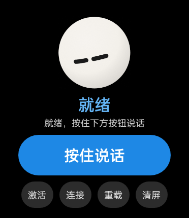
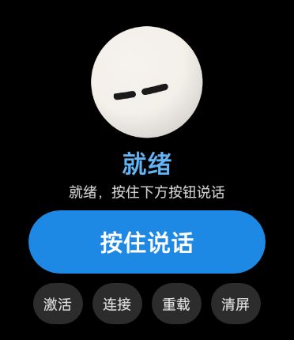
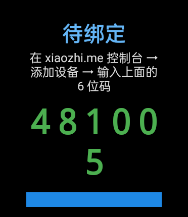

<div align="center">

# 小智手表端 · Xiaozhi on OPPO Watch 2

**把一块真正的安卓手表，变成小智 AI 的语音伙伴。**

OPPO Watch 2 · 纯客户端直连官方云 · 免 Gradle · APK 约 350 KB


<a href="https://github.com/kidnappe/xiaozhi-watch/releases">Releases</a> · <a href="app/P1_RESULTS.md">端到端实测</a> · <a href="app/NEW_EMOTIONS.md">表情管线</a> · <a href="XIAOBU_TAKEOVER.md">上键接管</a>

</div>

<p align="center">
  
  
  
</p>

<p align="center"><sub>左：就绪与按住说话　·　中：共情回应　·　右：激活绑定</sub></p>

---

## 它是什么

这是小智 AI 的**手表端客户端**：跑在 OPPO Watch 2（OWW202，Android 8.1 / API 27）上，按住说话，云侧完成识别、思考和语音合成，手表播放回答。

它不是把手机客户端简单缩小，而是针对手表的硬件和系统约束重做了一遍：

- 纯客户端直连小智官方云 `wss://api.tenclass.net`，不需要自建服务器；
- 零 root，ADB 侧载即可；
- 不依赖 Gradle，用 `build.ps1` 直接调用 Android 工具链构建；
- APK 约 350 KB，纯 Java，无 native 库。

据我们所知，这是小智生态里第一个跑在安卓手表真机上的客户端。

---

## 和手机客户端的区别

| | 手机小智客户端 | 小智手表端 |
|---|---|---|
| 交互 | 点按、长按、打字 | **按住说话**，抬手即用 |
| 连接 | 通常常驻 WebSocket | **按需连接**：按住时建连，空闲主动断开 |
| 反馈 | 屏幕 UI | **共情表情球** + 媒体音效 + 分级震动 |
| 入口 | App 图标 | 表盘图标 + ColorOS 上键长按 |
| 资源 | 手机性能充足 | 32 位 armv7、约 878 MB RAM、无 root |

---

## 功能

- **共情回应表情球**（移植自 [NX_emotion-ball](https://github.com/sam70361/NX_emotion_ball)，40+1 种数据驱动表情）：球是对话的另一方，而不是复读机。你说“我生气了”，它低头耷眼心疼，而不是跟着红脸。
- **按需连接**：待机不挂 WebSocket，按住说话当场建连；未就绪时按下自动排队，握手一到自动开麦；空闲 20 秒主动断开，息屏立即收线，亮屏自动预连。
- **抬手即说**：接管 ColorOS 的上键长按广播（禁用小布后可直接拉起小智并自动开麦 8 秒），也接管表盘“小布”图标入口。
- **戳互动**：单点轻晃、连击递进（好奇 → 满意 → 被戳晕）、长按 rua 头（眯眼蹭头，久 rua 转安静陪伴）、AI 说话中戳球可打断。
- **多通道反馈**：媒体通路合成音效（默认开启）、真机马达分级震动、表情球目光跟随手腕倾角。
- **穿戴级工程约束**：32 位 armv7 纯 Java 全链路（Concentus Opus / Java-WebSocket，零 native）；`AudioSource.MIC` 与媒体播放通路、Device-Id 大小写敏感等踩坑记录都写在文档里。

---

## 硬件平台（实测约束）

| 项 | 值 |
|---|---|
| 屏幕 | **372×430 方屏（圆角矩形）** @320dpi；不是圆屏，圆形的是表盘设计 |
| SoC / 系统 | armv7 32 位 / ColorOS Watch（Android 8.1，API 27），RAM 约 878 MB |
| 麦克风 | 仅 `AudioSource.MIC` 可用（`VOICE_COMMUNICATION` 近乎聋） |
| 扬声器 | 仅 `USAGE_MEDIA` 通路有声；`AudioTrack` 只认 `MODE_STREAM` |
| 网络 | 默认经手机蓝牙代理（`COMPANION_PROXY`），上行约 19 kbps |
| 权限 | 无 root / 无 fastboot，仅 APK 侧载 |

---

## 功能状态

| 阶段 | 内容 | 状态 |
|---|---|---|
| P0 | 音频能力探针（录音 / 播放 / Opus 压测） | 已完成，代码在 `probe_audio/` |
| P1 | 按住说话端到端（WS 协议 + Opus + 激活流程） | 已完成，真机跑通 |
| P2 | 表情球 + 共情回应 + 待机氛围轮换 + 戳互动 | 已完成，真机验证 |
| — | 按需连接 / 抬手预连 / 震动音效 / 新表情管线 | 已完成，真机验证 |
| P3 | 唤醒词（sherpa-onnx KWS）/ 自动续听 / AEC 实时打断 | 计划 |
| P4 | 手表传感器 MCP（心率 / 血氧 / HRV / 心情） | 计划 |

---

## 快速开始

### 环境

- Windows
- JDK 17
- Android build-tools 33（含 `aapt2` / `d8` / `zipalign` / `apksigner`）
- adb；不需要 Android Studio

```powershell
# 1) 依赖 jar 放到 libs/（见 LICENSE 第 3 条的三个坐标）
# 2) 构建（脚本内工具链路径按你本机修改）
powershell -NoProfile -ExecutionPolicy Bypass -File app\build.ps1

# 3) 安装并启动
adb install -r app\out\app.apk
adb shell am start -n com.xiaozhi.watch/.MainActivity

# 查看日志
adb logcat -s XZW
```

首次启动会自造设备身份（随机 `02:` 本地管理位 MAC，**必须小写**，官方服务端大小写敏感），用 test-token 直连即可对话。想绑定自己的智能体：点表上的“激活”取 6 位码，去 [xiaozhi.me](https://xiaozhi.me) 控制台输入。

### 调试命令

```bash
# 自动按住说话
adb shell am start -n com.xiaozhi.watch/.MainActivity --ei talkms 4000 --ei loop 3

# 模拟连戳（互动自检）
adb shell am start -n com.xiaozhi.watch/.MainActivity --ei poke 6

# 表情循环演示
adb shell am start -n com.xiaozhi.watch/.MainActivity --es emo loop
```

> 充电时 ColorOS 的充电覆盖窗会挡住截屏，验证以 `logcat` / `gfxinfo` 的客观数据为准。

---

## 项目结构

```text
app/                主客户端（纯 Java，无 Gradle，build.ps1 七步构建）
  src/com/xiaozhi/watch/
    XiaozhiClient    协议状态机 + 按需连接 + 音频管线
    MainActivity     UI / 手势 / 氛围轮换 / 戳互动决策 + 传感器 / 触觉
    EmotionBallView  表情球渲染引擎（上游衍生，非商用，见 LICENSE）
    LocalEmotion     用户情绪识别 → 共情回应映射
    DeviceIdentity   自造设备身份（小写 MAC + UUID）
    OtaClient        官方激活 / 绑定流程
probe_audio/       P0 音频能力探针（独立小 App）
tools/             协议探针（ws_probe / ota_probe / raw_dump / stub_server）+ 表情生成管线
```

延伸阅读：`app/P1_RESULTS.md`（端到端实测）· `app/NEW_EMOTIONS.md`（表情设计与生成管线）· `app/POKE_INTERACTION.md`（戳互动）· `XIAOBU_TAKEOVER.md`（上键长按接管）· `probe_audio/`（P0 音频探针）。

---

## 已知限制

- 只针对 OPPO Watch 2（OWW202，Android 8.1 / API 27）验证过；其他手表需要自行适配屏幕、音频和权限。
- 没有唤醒词，必须按住说话；P3 的自动续听和 AEC 实时打断尚未实现。
- 没有常驻后台连接；待机时不会保持在线，这是为了省电和规避官方云的空闲回收。
- 依赖手表侧载和 ADB，不是应用商店安装包。
- 表情球相关资产继承上游的非商用限制，整体商用前必须阅读 `LICENSE`。

---

## 许可与免责

- 本仓库自研代码采用 **MIT**；但**表情球相关代码衍生自 NX_emotion-ball，继承其“仅供学习交流、禁止商用”限制**。整体商用前请先读 [`LICENSE`](LICENSE) 第 2 条；仓库也提供了“无表情球干净版”的移除指引。
- 与小智官方无任何隶属关系；连接官方云仅作普通客户端使用，请遵守其服务条款并克制使用。
- 仓库不含任何服务端部署、License 绕过或激活码滥用内容。
- 仓库不携带任何 OPPO 固件或反编译产物；`references/`（上游素材与本机分析材料）已被 `.gitignore` 排除。

---

## 致谢

- [78/xiaozhi-esp32](https://github.com/78/xiaozhi-esp32) 与 [xiaozhi.me](https://xiaozhi.me)：协议与官方云
- [78/xiaozhi-sf32](https://github.com/78/xiaozhi-sf32)：最同构的手表级参照
- [sam70361/NX_emotion-ball](https://github.com/sam70361/NX_emotion_ball)：表情球上游
- [Concentus](https://github.com/opus-codec) / [Java-WebSocket](https://github.com/TooTallNate/Java-WebSocket)：纯 Java Opus 与 WebSocket
- 社区客户端参照：[py-xiaozhi](https://github.com/huangjunsen0406/py-xiaozhi)、[xiaozhi-android-client](https://github.com/TOM88812/xiaozhi-android-client)、[xiaozhi-client](https://github.com/shenjingnan/xiaozhi-client)
